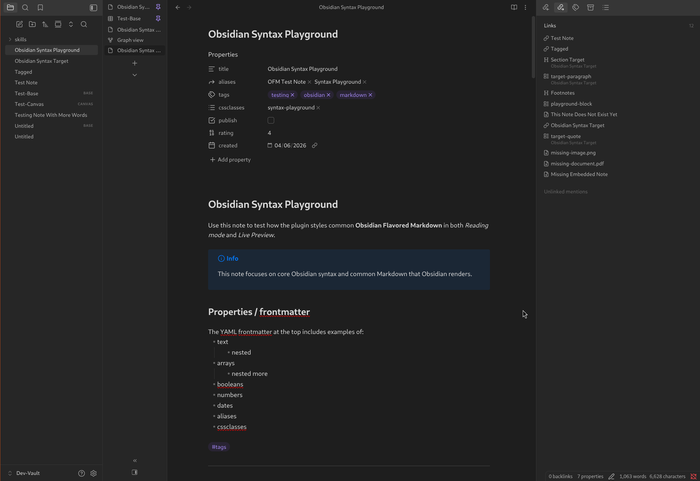

# Just Vertical Tabs 

Enables you to have note tabs aligned vertically instead of horizontally. 

## Features 

- Vertical Tabs 
- Orient tab bar on the left, or the right
- Stable left-sidebar button at the top-left of the active note header, before navigation; the native control remains available when the header is hidden
- Right-sidebar toggle placement options: native, note header, or bottom of the vertical tab bar (custom buttons stay in place when toggled)
- Optional tab icons toggle
- Command + setting to collapse the tab bar down to icons, or title initials when icons are hidden
- Independent collapse/expand button in the vertical tab bar, above the sidebar button when both are at the bottom
- Optional toggle to hide/show the collapse/expand button

## Installation

1. Install and enable [BRAT](https://github.com/TfTHacker/obsidian42-brat) through the Community Plugins
2. Open the Obsidian settings, and navigate to the BRAT settings page
3. Click the "Add beta plugin" button
4. Paste the link to this repository in the Repository field
5. Make sure the "Enable after installing the plugin" box is checked
6. Click the "Add plugin" button

## Development checks

- `npm run lint` and `npm run build`
- Reload the plugin in a running development vault, then run `npm run test:integration -- <vault-name>` (Node 22.6+ and the Obsidian CLI required).
- The integration checks exercise real sidebar animations, both tab-bar sides and widths, placement settings, header visibility, split changes, and unload cleanup. They temporarily change the UI and reload the plugin, restoring settings and sidebar state afterward; use a development vault with a note open and avoid interacting during the run.
